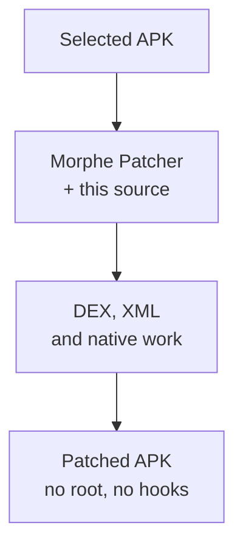

<a name="top"></a>
<p align="center">
  <a href="https://github.com/kveld9/kveld-morphe-patches/releases/latest"></a>
  <a href="https://github.com/kveld9/kveld-morphe-patches/stargazers"></a>
  <a href="https://github.com/kveld9/kveld-morphe-patches/releases"></a>
  
  <a href="LICENSE"></a>
</p>

<h1 align="center">Morphe Patches</h1>

<p align="center">
  Simple tweaks for <b>Brave Browser</b>, <b>Gboard Lite</b>, <b>Hevy</b>, <b>TikTok</b>, <b>NokoPrint</b>, and <b>Xiaomi Earbuds</b> on Android: fewer ads, less tracking, less battery drain. Applied with the <b><a href="https://morphe.software">Morphe</a></b> patcher.
</p>

<p align="center">
  <a href="https://morphe.software/add-source?github=kveld9/kveld-morphe-patches"></a>
  &nbsp;&nbsp;
  <a href="https://github.com/kveld9/kveld-morphe-patches/releases/latest"></a>
  &nbsp;&nbsp;
  <a href="https://t.me/kveldmorphe"></a>
</p>

---

<a name="table-of-contents"></a>
## Table of Contents


- [Quick Start](#quick-start)
- [Key Advantages](#key-advantages)
- [Supported Targets & Downloads](#supported-targets)
- [Patch Catalog](#patch-catalog)
- [Documentation & Guides](#documentation)
- [Contributing & Feature Requests](#contributing)
- [Community & Support](#community)
- [Credits & Contributors](#credits)
- [Legal Disclaimer](#legal)
- [License](#license)

---

<a name="quick-start"></a>
## Quick Start


1. Install **Morphe Manager** on your Android device.
2. Download the target app using the **exact version and variant** listed in [Supported Targets & Downloads](#supported-targets) (a version mismatch makes every fingerprint fail).
3. Add this repository as a patch source with the button above, or add `https://github.com/kveld9/kveld-morphe-patches` manually.
4. Select the patches, keep a copy of the original APK, run the patcher, and install the rebuilt APK.

> [!NOTE]
> Requirements: the Morphe patcher on your device (patching happens on-device, no root needed); always use the exact ABI/variant from the table below.

---

<a name="key-advantages"></a>
## Key Advantages


- **No slowdown**: changes are baked into the app itself. No background services, no VPNs, no extra apps running.
- **Real privacy**: tracking and crash reporting are switched off inside the app, not just blocked on the network.
- **Smaller apps**: unused languages, files and extras are removed to save space and memory.
- **No root needed**: patching happens on your device with Morphe Manager. No root, no computer.
- **Always up to date**: every app targets its latest version, checked exactly before patching.



---

<a name="supported-targets"></a>
## Supported Targets & Downloads


> [!TIP]
> For CPU architecture guidelines (ARM64 vs 32-bit ARMv7a) and variant selection rationales, consult the [Compatibility Guide](docs/compatibility.md).

<!-- GENERATOR-SYNC: generate_patches_readme.py rewrites version cells and download URLs in this table in place via literal regexes — do not rename app cells, reorder columns, or remove backticks -->

| Application | Package ID | Target Version | Architecture / Variant | Download Source | Complete Guide |
| :--- | :--- | :--- | :--- | :--- | :--- |
| **Brave Browser** | `com.brave.browser` | `1.97.56` | `arm64-v8a`<br>`armeabi-v7a` (Monolithic) | [ARM64](https://github.com/brave/brave-browser/releases/download/v1.97.56/Bravemonoarm64.apk) · [ARM32](https://github.com/brave/brave-browser/releases/download/v1.97.56/BraveMonoarm.apk) | [Brave Guide](docs/apps/brave.md) |
| **Gboard Lite** | `com.google.android.inputmethod.latin` | `18.4.1.985164140-lite_beta` | `arm64-v8a`<br>`armeabi-v7a` (nodpi) | [APKMirror](https://www.apkmirror.com/apk/google-inc/gboard/gboard-the-google-keyboard-18-4-1-985164140-beta/) | [Gboard Lite Guide](docs/apps/gboard.md) |
| **Hevy** | `com.hevy` | `3.1.14` | `arm64-v8a` (APKM Bundle) | [APKMirror](https://www.apkmirror.com/apk/hevy-gym-workout-tracker/hevy-gym-log-workout-tracker/hevy-gym-log-workout-tracker-3-1-14-release/) | [Hevy Guide](docs/apps/hevy.md) |
| **NokoPrint** | `com.nokoprint` | `5.28.6` | Universal (nodpi) | [APKPure](https://d.apkpure.com/b/XAPK/com.nokoprint?versionCode=52806) | [NokoPrint Guide](docs/apps/nokoprint.md) |
| **TikTok** | `com.zhiliaoapp.musically` | `47.1.4` | `arm64-v8a` (nodpi) | [APKMirror](https://www.apkmirror.com/apk/tiktok-pte-ltd/tik-tok-including-musical-ly/tiktok-47-1-4-release/) | [TikTok Guide](docs/apps/tiktok.md) |
| **Xiaomi Earbuds** | `com.mi.earphone` | `1.38.0i` | Universal (XAPK Bundle) | [APKPure](https://d.apkpure.com/b/XAPK/com.mi.earphone?versionCode=138000) | [Xiaomi Earbuds Guide](docs/apps/xiaomi-earbuds.md) |

Legend: `nodpi` = density-independent resources; `APKM`/`XAPK` = bundles that Morphe merges; `Monolithic` = single APK.

<details>
<summary><b>Troubleshooting</b></summary>

- **App not installed / signature conflict**: the patched APK is re-signed; uninstall the original app first (for Gboard, **Install a Copy** installs in parallel).
- **Google login broken (TikTok)**: enable **Fix Google Login**.
- **Patcher applies nothing / fingerprint errors**: use the exact version and variant from the table above.
- **Crash after patching**: disable the last patch you enabled and retry.

</details>

---

<a name="patch-catalog"></a>
## Patch Catalog


<!-- PATCHES_START -->
<details>
<summary>TikTok&nbsp;&nbsp;•&nbsp;&nbsp;<b>72 patches</b></summary>
<br>

**Supported versions:**

| 47.1.4 |
| :---: |

| Patch | Description | Options |
|----------|----------------|-----------|
| **Always Show Publish Date** | Forces video publish/upload date to remain visible in video author information across all feed types. |  |
| **Auto-Pause First Video** | Automatically pauses the first video when opening TikTok, allowing the application to finish background initialization and preventing playback lag. |  |
| **Bypass Mandatory Login** | Neutralizes mandatory login walls, dynamic regional forced login gates, and guest browsing restrictions. |  |
| **Bypass Screen Capture Detection** | Clears FLAG_SECURE on protected windows, restores Circle to Search / screen translate and recent apps snapshots, and neutralizes screenshot detection listeners and feedback prompts. |  |
| **Camera & Microphone Indicator** | Shows a corner mark while TikTok holds camera/mic open. |  |
| **Clean Share Panel** | Removes clutter from the share panel and direct message dialog, including suggested quick emojis and the 'Send to new group' button. | • Hide Quick Emojis<br>• Hide 'Send to New Group' |
| **Clean Share URL** | Strips tracking parameters, user IDs, device fingerprints, and marketing tokens from shared TikTok links, with optional custom host redirection. | • Custom Share Host |
| **Client-Side AI & Behavioral Profiling Governor** | Neutralizes on-device machine learning inference (Pitaya), Tako AI chatbot entry points and icons, and AI smart search suggestion clutter. |  |
| **Comment Customizer** | Customizes TikTok's comment section, including native sort controls, clean text copying, disabling suggested emojis bar, hiding comment quick actions, hiding in-comment surveys and feedback cards, hiding profile photo story rings, enabling voice comments, automatic comment translation, fixing silent comment drops, and hiding comment popup ads. | • Comment Sort Controls<br>• Fix Silent Comment Drops<br>• Copy Comments Without Username<br>• Disable Suggested Emojis<br>• Hide Comment Quick Actions<br>• Hide Comment Surveys & Feedback Cards<br>• Hide Comment Story Rings<br>• Enable Voice Comments<br>• Hide Comment Popup Ads<br>• Show Community-Flagged Comments<br>• Auto-Translate Comments<br>• Do-Not-Translate Languages |
| **Core Asset De-bloat** | Strips embedded Microblink/FinTech card scanner models, Pitaya AI & ByteNN LLM engines, C2PA origin verification, DLNA cast scanners, and redundant non-Latin fonts to save APK space. |  |
| **Custom Offline Videos Limit** | Customizes the maximum number of videos available for offline download caching. | • Custom Offline Videos Limit |
| **Custom Share Sheet** | Customizes and cleans the native TikTok share sheet via individual toggle switches for third-party apps, essential sharing features, and secondary utility actions. | • Hide WhatsApp<br>• Hide Instagram<br>• Hide Facebook & Messenger<br>• Hide Telegram<br>• Hide X / Twitter<br>• Hide Snapchat<br>• Hide Reddit & Discord<br>• Hide SMS & Messages<br>• Hide Secondary Networks<br>• Hide 'Repost' Button<br>• Hide QR Code<br>• Hide 'Copy Link'<br>• Hide System Share ('More')<br>• Hide Friends / Direct Messages Row<br>• Hide 'Promote' Action<br>• Hide 'Why This Video'<br>• Hide 'Create Group' Action<br>• Hide 'Add to Story'<br>• Hide 'Create Sticker'<br>• Hide 'Duet' Action<br>• Hide 'Stitch' Action<br>• Hide 'Picture-in-Picture' (PiP)<br>• Hide 'Clear Display'<br>• Hide 'Background Audio'<br>• Hide Live Wallpaper & GIF<br>• Hide 'Not Interested'<br>• Hide 'Report' |
| **Device Privacy Guard** | Neutralizes invasive runtime permissions, contacts queries, package inventory inspection, location hardware tracking, advertising ID profiling, background clipboard snooping routines, and motion sensor profiling to protect user data. |  |
| **Direct Message Declutter** | Removes visual clutter in direct messages and chat list, including the call button, reaction tray, message forward button, camera icons, input action buttons, try effect button, sticker reply suggestions, and the typing-triggered sticker strip. | • Hide Chat List Camera Button<br>• Hide Header Call Button<br>• Hide Message Forward Button<br>• Hide Reaction and Streak Bar<br>• Hide Input Bar Camera Button<br>• Hide Gallery Button<br>• Hide Emoji/Stickers Button<br>• Hide Voice Recording Button<br>• Hide Try Effect Button<br>• Hide Sticker Reply Suggestions |
| **Disable Double Tap to Like** | Disables double tap like in the feed. |  |
| **Disable Feed Long-Press Actions** | Disables long-press action gestures on feed buttons, including Like to repost, Share to quick DMs, and Comment to quick emojis, with optional long-press video body redirection. | • Disable Long-Press Like (Repost)<br>• Disable Long-Press Share (Quick DMs)<br>• Disable Long-Press Comment (Quick Emojis)<br>• Long Press Video Action |
| **Disable HDR Video Playback** | Forces the video playback engine to select standard SDR bitrates (BT.709/sRGB) instead of HDR (HDR10/PQ/HLG), preventing blinding screen brightness spikes and display thermal throttling while preserving smooth playback. |  |
| **Disable Post-Download Share Dialog** | Suppresses the automatic 'Share to' and friend suggestions bottom sheet that pops up after finishing a download. |  |
| **Disable Profile Photo LIVE Status** | Removes the pulsing LIVE ring and badge from creator avatars in the feed and ensures clicking navigates strictly to the user profile instead of launching the live stream. |  |
| **Disable Push Notifications** | Neutralizes background push notification tasks and persistent socket wake locks to eliminate background battery drain. |  |
| **Disable Search History Recording** | Prevents search queries and keywords from being recorded in local history, databases, and analytics stores. |  |
| **Disable Search Video Autoplay** | Disables automatic video playback in search results. Videos only play when tapped to view in detail. |  |
| **Disable Watch History Recording** | Prevents viewed videos from being recorded in account watch history, playback duration stores, and local history caches. |  |
| **Display Refresh Rate Governor** | Forces TikTok to run at peak display refresh rate (120Hz/90Hz/60Hz) and neutralizes video playback framerate downclocking routines. | • Target Refresh Rate |
| **Enable Live Search** | Shows TikTok's search entry in the Live drawer where supported. |  |
| **Enable Profile Banner** | Unlocks the custom profile banner (background header cover) feature on user profiles and enables the banner selection and editing tools in Edit Profile. |  |
| **Feed Ad Blocker** | Removes sponsored advertisements, brand promotions, and promotional audio from the For You, Following, and Search feeds. |  |
| **Feed Bloat & Distraction Blocker** | Removes non-video clutter and floating ad widgets from the For You, Following, and Friends feeds, including Touchpoint Rewards pendants, floating ad stickers, suggested friend cards, mini-games, CapCut/template creation prompts, memories ('On This Day'), community/topic cards, post-video surveys and evaluation questionnaires, mini-drama paywalls, and in-feed search recommendations/interest cards. |  |
| **Feed Content Filter** | Hides stories, photo posts, and videos outside configured view or like ranges from the For You feed only. Following, Friends, profiles, search and other surfaces are never filtered. | • Minimum Views<br>• Maximum Views<br>• Minimum Likes<br>• Maximum Likes<br>• Hide Stories<br>• Hide Photo Posts |
| **Feed Interface Declutter** | Customizes and cleans feed video overlay elements, including the full screen button, repost pill, interest feedback pills, video descriptions, profile photo follow badges, story rings, playlist bottom bars, save buttons, and music discs. | • Hide Repost Badge<br>• Hide Video Descriptions<br>• Hide Profile Photo Follow Button<br>• Disable Story Feed Indicators<br>• Hide Playlist Bottom Bar<br>• Hide Save Button<br>• Hide Music Cover Disc<br>• Hide Full Screen Button<br>• Hide Feedback Buttons |
| **Feed Live Stream Blocker** | Removes live stream broadcast cards and live recommendations from the For You and Following feeds. |  |
| **Fix Google Login** | Restores Google account sign-in after patching by forcing fallback to Web-based OAuth when Google Play Services rejects the modified APK signature. |  |
| **Fix Spotify Login** | Restores the 'Add to Spotify' music button after patching by routing the Spotify app sign-in, which rejects the modified APK signature, through Spotify's Web-based OAuth. |  |
| **Force Auto-Scroll** | Forces the activation of the native video auto-scroll experiment flag for accounts and regions that lack it due to A/B testing. |  |
| **Friends Feed Strict Mutuals** | Filters out suggested accounts, recommended videos, and non-mutual profiles (such as 'People you may know') from the Friends feed so it only plays videos from accounts you mutually follow. |  |
| **Hide AI-Generated Content** | Filters and skips videos tagged with native AI-generated metadata, C2PA content credentials, or creator AI disclosure tags across the For You, Following, and Friends feeds. |  |
| **Hide Inbox Promos & Alerts** | Hides promotional banners, streak mascot cards, contact sync suggestions, friend recommendations, and migration guide tooltips in the inbox and direct messages. | • Hide Top Promotional Banners<br>• Hide Contact & Friend Recommendations<br>• Hide Navigation Notices & Tooltips |
| **Hide Inbox Story & Status Tray** | Hides the horizontal story, notes, and status tray (Skylight) displayed at the top of direct messages and the inbox. | • Hide Suggested Stories Only |
| **Hide Popular Lives In Search** | Removes the Popular LIVEs recommendation card and live stream broadcasts from the search discovery page. |  |
| **Hide Seen Videos** | Filters previously watched videos from incoming For You feed batches. |  |
| **Hide Suggested Accounts** | Removes suggested-account cards from profile headers and inbox surfaces. |  |
| **Hide Suggested Searches** | Removes the suggested search keywords section ('You may like' / 'Search suggestions') from the search discovery page. |  |
| **Hide TikTok Shop & Mall** | Removes product showcase badges, shopping cart tags, and the TikTok Shop / Mall tab from navigation bars and video posts. | • Hide Shop Navigation Tab<br>• Hide Video Product Anchors |
| **In-App Browser Privacy Guard** | Redirects external and third-party web links to the default system browser and neutralizes inline JavaScript tracking, DOM monitoring, and AJAX hooking in residual in-app WebViews. |  |
| **Instant Launch & Splash Blocker** | Eliminates cold startup delays, background resume splash advertisements, real-time splash requests, and TopView ad preloading. |  |
| **Language Pack Purger** | Strips unselected language string bundles from assets/strings#lang_* to save APK space. | • Languages to keep |
| **Live Stream 3D Gift Optimizer** | Disables Live 3D gift particle effect engine and widget rendering lifecycle to eliminate frame drops during live streams. |  |
| **Live Stream SDK & Minigame De-bloat** | Strips Live link mic SDK (liblink_mic_sdk.so), Lyrax RTC broadcasting engines (liblyrax.so), DM voice/video call engine (libvoip.so), live RTM messaging (librtmglobal.so) and live base runtime (libbase_live.so), plus live stream interactive minigames to reduce APK size and memory footprint. Breaks live viewing/broadcasting and direct message calls. |  |
| **Media Usability & Watermark-Free Downloader** | Unblocks the download button on creator-restricted videos inside the Share panel, and routes downloads to clean unwatermarked media streams. | • Remove Watermark<br>• Saved-Video Quality Preference |
| **Navigation & Header Declutter** | Removes clutter from the feed navigation and top header bar, including the Nearby feed tab, Community (Explore) tab, top-left LIVE broadcast button, central '+' create content button, in-video bottom search suggestion bar, friend profile photo previews on the bottom Friends tab, and unread notification badges on the bottom Messages (Inbox) tab. | • Hide Nearby Feed Tab<br>• Hide Community Tab<br>• Hide Top-Left LIVE Button<br>• Hide Feed Search Bar<br>• Hide Create / Publish Button<br>• Hide Friends Tab Avatar Preview<br>• Hide Inbox Notification Badge |
| **Non-Personalized Search** | Forces TikTok's non-personalized search mode instead of the saved account choice. |  |
| **P2P Video Relay & Mesh CDN Blocker** | Strips background Peer-to-Peer CDN distribution binaries (libavmdlp2pv2.so and libp2plivevdp.so) to prevent battery drain, background data upload, and mesh relay. |  |
| **Playback Speed Persistence** | Persists selected video playback speed across all feed videos and application restarts, and optionally enables the native hold-and-slide 2x speed lock gesture. | • Hold-And-Slide 2x Speed Lock |
| **Popups & Prompts Suppressor** | Suppresses intrusive popups, dialogs, and modal prompts, including 'Follow your friends' dialogs, contacts sync overlays, multi-account notification guides, 2SV security checkup modals, PopLayer promotional sheets, live stream teaser bubbles, sticker recommendations, and DM streak expiration warnings. | • Suppress Account & Permission Nags<br>• Suppress Sticker Recommendations<br>• Filter PopLayer Prompts & Nags<br>• Suppress Live Teaser Bubbles<br>• Suppress DM Streak Reminders |
| **Remember Clear Display** | Remembers TikTok's clear-display state between videos and re-applies it when new videos start. |  |
| **Resource & Battery Governor** | Throttles background sensor polling (gyroscope/accelerometer 3D ads) and prevents aggressive video buffer preloading to conserve battery and CPU resources. |  |
| **Resume Video After Scroll** | Remembers playback timestamp when scrolling away and resumes from where playback stopped upon returning. |  |
| **SIM Region Selector** | Spoofs the detected SIM and network country ISO code, operator numeric codes, operator names, and cell identity MCC/MNC to bypass regional feed restrictions and catalog blocks. | • Spoofed Region ISO Code<br>• Spoofed Operator Numeric Code (MCC+MNC)<br>• Spoofed Operator Name |
| **Show Author Region** | Displays the creator's country or region code next to their username in video author info across feeds and deep-linked detail views. |  |
| **Show Seekbar** | Restores TikTok's native video seekbar and scrubbing controls where normally hidden or disabled. | • Show Dragging Thumbnail Preview |
| **Skip Content Warnings** | Bypasses and clears sensitive content warnings, graphic media blur overlays, and age gates on feed videos. |  |
| **Skip First-Launch Onboarding** | Bypasses the entire first-run introduction funnel (interest pickers, swipe tutorials, language prompts, and consent sheets) directly to the feed. |  |
| **Stop Video Looping** | Stops videos at the end instead of replaying them in an infinite loop. |  |
| **Studio & Creation De-bloat** | Strips heavy video creation plugins, CapCut NLE editor SDKs, effect plugins, camera dynamic features, upload video encoders, on-device AI runtimes (LiteRT), and AR camera face models to significantly reduce APK size. |  |
| **System Font** | Forces TikTok to use the Android system font instead of bundled proprietary TikTokSans fonts. |  |
| **Telemetry Manifest Purge** | Strips advertising and attribution permissions, disables telemetry receivers/services (AppLog, AppsFlyer, Measurement, DataTransport), prunes Firebase analytics/transport registrars, and injects opt-out metadata (Firebase, AppsFlyer, Meta). |  |
| **TikTok Privacy Permissions Stripper** | Selectively strips sensitive privacy, sensor, hardware, and tracking permissions from AndroidManifest.xml via configurable boolean toggles. | • Strip Notification Permission<br>• Strip Camera Permission<br>• Strip Microphone Permissions<br>• Strip Storage & Media Permissions<br>• Strip Bluetooth Permissions<br>• Strip NFC Permission<br>• Strip Biometric Permissions<br>• Strip Foreground Service Permissions<br>• Strip System Alert Window Permission<br>• Strip Wake Lock Permission<br>• Strip Screenshot & Recording Detection Permissions<br>• Strip Miscellaneous Hardware & System Permissions<br>• Strip OEM Diagnostic & Background Signals<br>• Strip Push Delivery Permissions<br>• Strip In-App Billing Permission |
| **Unified Telemetry & Tracker Silencer** | Neutralizes ByteDance AppLog user tracking, APM/Npth/Heimdallr crash monitors, AppsFlyer attribution, and Firebase analytics. |  |
| **Update Prompt Suppressor** | Neutralizes background update polling tasks and device ID check routines to prevent forced update popups. |  |
| **Video Fit** | Adjusts video display aspect ratio across feeds and story cells: 'fit' ensures the entire video is visible without cropping, or 'fill' expands the video to fill the screen. | • Video Fit Mode |
| **Video Quality Governor** | Caps video playback resolution (1080p, 720p, 540p, 480p, 360p) to conserve battery, GPU/MediaCodec load, and mobile data. Download quality is controlled separately by the Media Usability patch (downloadQuality). | • Maximum Playback Resolution<br>• Avoid ByteVC2 Software Decoding<br>• Drop Undecodable Video Streams |
| **Voice & Speech Engine De-bloat** | Strips on-device voice recognition and speech synthesis engines (libspeechspg.so, libspeechsdk.so) and their loader stubs (libspeechengine.so, libspeechepg.so) to save APK space. Breaks voice search (microphone button), voice input, and editor text-to-speech/sing features. |  |

</details>

<details>
<summary>Brave Private Web Browser, VPN&nbsp;&nbsp;•&nbsp;&nbsp;<b>16 patches</b></summary>
<br>

**Supported versions:**

| 1.97.56 |
| :---: |

| Patch | Description | Options |
|----------|----------------|-----------|
| **Better Tab Closing** | Closing a tab picks the previous tab in the same group. |  |
| **Block Motion Sensors** | Stops sites from reading motion sensors to identify you. |  |
| **Block Popups & Rating Requests** | Blocks rating popups, review requests and promo dialogs. |  |
| **Block Tracking** | Blocks usage analytics, crash uploads and experiment downloads. | • Block offers server |
| **Brave Origin** | Unlocks Brave Origin feature switches. |  |
| **Clean Shared Links** | Removes tracking codes from links you share or copy. |  |
| **Clean Start Page** | Removes sponsored wallpapers, news feed and promo cards. | • Hide shortcut tiles |
| **Faster Startup** | Speeds up launch by disabling carrier customizations. |  |
| **Hide Battery Status** | Stops sites from reading your battery level to track you. |  |
| **Keep Tabs Open** | Stops Brave from minimizing your tabs in the background. |  |
| **Remove Extra Languages** | Deletes unused language packs. | • Languages to keep |
| **Remove Unused Parts** | Deletes unused AI, VPN and AR files to shrink the app. |  |
| **Silence Promo Notifications** | Stops tips, reward promos and marketing notifications. |  |
| **Skip Welcome Screens** | Skips welcome, search choice and onboarding on fresh installs. |  |
| **Stop Background Sync** | Stops background wakeups and battery drain. |  |
| **Stop Text Sharing with System** | Stops sending page text to the Android capture service. |  |

</details>

<details>
<summary>NokoPrint - WiFi, Bluetooth, USB&nbsp;&nbsp;•&nbsp;&nbsp;<b>7 patches</b></summary>
<br>

**Supported versions:**

| 5.28.6 |
| :---: |

| Patch | Description | Options |
|----------|----------------|-----------|
| **Block Ads** | Blocks ad loaders and unlocks ad-free status. |  |
| **Block Trackers** | Blocks analytics and ad tracking. |  |
| **Remove Ad Files** | Deletes hidden ad files and trackers to shrink the app. |  |
| **Remove Extra Stores** | Disables payment components for other app stores you do not use. |  |
| **Safer Connections** | Uses trusted certificates while keeping printer downloads working. |  |
| **Skip Welcome Screen** | Skips the first-launch popup (the About menu still works). |  |
| **Stop Background Sync** | Stops background tasks that drain the battery. |  |

</details>

<details>
<summary>Gboard Lite&nbsp;&nbsp;•&nbsp;&nbsp;<b>11 patches</b></summary>
<br>

**Supported versions:**

| 18.4.1.985164140-lite_beta-arm64-v8a | 18.4.1.985164140-lite_beta-armeabi-v7a |
| :---: | :---: |

| Patch | Description | Options |
|----------|----------------|-----------|
| **Block App Hijacking** | Protects against other apps hijacking Gboard and removes debug tools. |  |
| **Block Trackers** | Stops background metrics, event logging and crash reporting. | • Block ad servers |
| **Install a Copy** | Installs this Gboard next to the original one. | • Copy name ending<br>• Copy display name |
| **Keyboard Settings** | Adds a settings screen inside Gboard: theme, vibration, clipboard and more. |  |
| **No Cloud Backup** | Keeps keyboard data off Google Drive backups. |  |
| **No Play Services** | Runs without Google Play services. Also turns off inline Translate. |  |
| **Offline Only** | Fully disconnects Gboard. Download dictionaries first. |  |
| **Remove Extra Files** | Deletes licenses, tutorial animations and junk. |  |
| **Remove Permissions** | Removes permissions you pick below. | • Contacts<br>• Microphone<br>• Photos & files<br>• Dictionary sync<br>• Work profile link |
| **Stop Background Sync** | Stops background downloads and sync to save battery. |  |
| **Stop Remote Updates** | Stops Google from changing settings remotely. |  |

</details>

<details>
<summary>Hevy - Gym Log Workout Tracker&nbsp;&nbsp;•&nbsp;&nbsp;<b>4 patches</b></summary>
<br>

**Supported versions:**

| 3.1.14 |
| :---: |

| Patch | Description | Options |
|----------|----------------|-----------|
| **Block Trackers** | Blocks crash reporting, ad attribution and referral tracking. |  |
| **Remove Extra Files** | Deletes tutorial videos, editor stickers and junk to shrink the app. |  |
| **Stop Background Sync** | Stops background sync tasks and alarms that drain the battery. |  |
| **Unlock Pro** | Unlocks Pro features stored on the device (routines, folders, charts). Server-limited items may still need a subscription. |  |

</details>

<details>
<summary>Xiaomi Earbuds&nbsp;&nbsp;•&nbsp;&nbsp;<b>11 patches</b></summary>
<br>

**Supported versions:**

| 1.38.0i |
| :---: |

| Patch | Description | Options |
|----------|----------------|-----------|
| **Block Trackers** | Stops analytics and usage reporting. |  |
| **Hide Device ID** | Hides hardware IDs and lets Bluetooth work without location. |  |
| **Offline Only** | Fully disconnects the app. Pair your earbuds first, then enable. |  |
| **Run on Rooted Devices** | Lets the app run on rooted phones and network tools without crashing. |  |
| **Safer Connections** | Blocks unencrypted traffic and allows inspection. |  |
| **Show All Models** | Shows every earbud model for pairing. |  |
| **Skip Popups & Tutorials** | Skips startup agreements, tutorials and promo banners. |  |
| **Stop Background Activity** | Removes persistent notifications and background battery drain. |  |
| **Unlock Sound Features** | Enables spatial audio and hearing features on all devices. |  |
| **Unlock for Other Phones** | Enables full features on Samsung, Pixel and other non-Xiaomi phones. |  |
| **Update Without Account** | Lets guests check and install earbud firmware updates. |  |

</details>

<details>
<summary>Universal&nbsp;&nbsp;•&nbsp;&nbsp;<b>15 patches</b></summary>
<br>

| Patch | Description | Options |
|----------|----------------|-----------|
| **Allow Screenshots** | Removes screenshot blocking and capture detection. |  |
| **Block Tracking SDKs** | Disables analytics, crash and ad SDKs inside the app. | • Performance monitors<br>• Crash reporters<br>• Analytics<br>• Ad attribution<br>• Old Google Analytics<br>• Push SDKs (breaks push!)<br>• Screen recorders<br>• Location trackers |
| **Block Tracking Servers** | Rewrites tracking addresses to nowhere using your blocklist. | • Blocklist file<br>• Replace with<br>• Include subdomains |
| **Clean App Packaging** | Removes build leftovers and duplicate files. |  |
| **Force Screen Timeout** | Makes apps respect your screen-off timer. |  |
| **Go Fully Offline** | Removes internet access completely. | • Network state<br>• Wi-Fi controls<br>• Push permissions<br>• Google sync<br>• Block unencrypted traffic |
| **Lock Screen Brightness** | Stops apps from changing brightness by themselves. |  |
| **Remove Extra Languages** | Deletes unselected translation folders. | • Languages to keep |
| **Remove Permissions** | Removes permissions you pick below. | • Notifications<br>• Camera<br>• Microphone<br>• Photos & files<br>• Location<br>• Contacts<br>• Calendar<br>• Nearby devices<br>• Body sensors |
| **Remove Trackers** | Removes ad IDs, disables tracking components and adds opt-outs. | • Ad permissions<br>• Tracking providers<br>• Tracking services<br>• Tracking receivers<br>• Opt-out flags<br>• Firebase init (may break apps)<br>• Push services (breaks push!)<br>• Google Analytics<br>• Meta analytics<br>• Crash uploaders<br>• Device ID (may break login!)<br>• ML Kit vision (breaks scanner!)<br>• Remote config (may break app!)<br>• Crashlytics (may break app!)<br>• Ad auto-start |
| **Remove Tracking Code** | Deletes tracking and crash-reporting native libraries. | • Crash reporters<br>• Debuggers |
| **Remove Unused Screen Sizes** | Deletes image folders for screen sizes you do not use. | • Screen sizes to keep<br>• Watch resources<br>• TV resources<br>• Car, dock and VR resources |
| **Shrink PNG Images** | Recompresses PNGs without losing quality. |  |
| **Shrink WebP Images** | Strips hidden metadata from WebP images. | • Camera data<br>• Editing history<br>• Color profiles |
| **Stop Background Wakeups** | Stops boot receivers and background schedulers that wake the app. | • Strip RECEIVE_BOOT_COMPLETED Permission<br>• Disable Boot & Package Receivers<br>• Disable WorkManager & Job Schedulers<br>• Strip WAKE_LOCK Permission |

</details>

<!-- PATCHES_END -->

<p align="center">
  <a href="#top"><b>&uarr; Back to top</b></a>
</p>

---

<a name="documentation"></a>
## Documentation & Guides


Technical references, setup manuals, and architecture notes are organized by focus area:

### Dedicated Application Guides
| Application | Guide | Description |
| :--- | :--- | :--- |
| **Brave Browser** | **[Brave Guide](docs/apps/brave.md)** | Faster start, no ads or tracking, clean start page. |
| **Gboard Lite** | **[Gboard Lite Guide](docs/apps/gboard.md)** | Offline dictionaries, keyboard settings, no tracking. |
| **Hevy** | **[Hevy Guide](docs/apps/hevy.md)** | Email login help, Pro unlock, less battery use. |
| **NokoPrint** | **[NokoPrint Guide](docs/apps/nokoprint.md)** | No ads, drivers keep working, safer connections. |
| **TikTok** | **[TikTok Guide](docs/apps/tiktok.md)** | Change country, block ads, save clean videos, save battery. |
| **Xiaomi Earbuds** | **[Xiaomi Earbuds Guide](docs/apps/xiaomi-earbuds.md)** | Pairing help, all models, sound unlocks, offline mode. |

### Universal & Architecture Reference
| Guide | Description |
| :--- | :--- |
| **[Universal Patches & Options](docs/universal-patches.md)** | Works on any app: remove languages, shrink images, go offline, block trackers, allow screenshots. |
| **[Compatibility Guide](docs/compatibility.md)** | CPU architecture policy (`arm64-v8a` vs `armeabi-v7a`), APK variant requirements, and SHA-256 baseline. |
| **[Project Scope & Out of Scope](docs/out-of-scope.md)** | Non-negotiable design philosophy, compile-time invariants, and rejected feature categories. |
| **[Architecture & Security Notes](docs/architecture-security.md)** | Static analysis scanner false positives (ML Kit, Play Billing) and native ELF telemetry neutralization. |

### Developer & Tooling
| Guide | Description |
| :--- | :--- |
| **[Building & Development](docs/building.md)** | Toolchain prerequisites, Gradle build tasks, test execution, and catalog synchronization. |
| **[Reverse Engineering & Update Harness](harness/README.md)** | Automated Python pipeline for multi-DEX indexing, obfuscated symbol resolution, and APK audits. |
| **[Physical & Runtime ADB Test Suite](validation/physical_harness/README.md)** | Automated on-device validation for battery consumption, ServiceWorker sync, and runtime telemetry. |

<p align="center">
  <a href="#top"><b>&uarr; Back to top</b></a>
</p>

---

<a name="contributing"></a>
## Contributing & Feature Requests


Before proposing new features or submitting modifications, please review our **[Project Scope & Out-of-Scope Philosophy](docs/out-of-scope.md)**.

> [!NOTE]
> We prioritize **small, fast changes** and keeping up with the latest app versions. Dynamic in-app settings panels, legacy multi-version support, server-side exploits, or heavy feature bloat are explicitly out of scope.

### Mandatory Verification Gates
Every patch modification or contribution must pass the official Morphe Patcher in-situ verification gate with 100% success (0 failed patches, 0 fingerprint mismatches):
```bash
# Execute in-situ patching test for target application
./gradlew runPatchTest -Papp=<targetApp>   # e.g., brave, gboard, hevy, tiktok, nokoprint, xiaomi_earbuds
```
Additionally, ensure all Gradle checks and automated harness tests pass cleanly:
```bash
./gradlew check
./venv/bin/python -m unittest discover harness/tests
```

---

<a name="community"></a>
## Community & Support


> [!NOTE]
> Need assistance, have questions regarding patch configurations, or want to follow release announcements? Join the official Telegram community:
>
> - **Telegram Support Group**: [t.me/kveldmorphe](https://t.me/kveldmorphe)
>
> - **Bug reports & feature requests**: [GitHub Issues](https://github.com/kveld9/kveld-morphe-patches/issues/new/choose)
> - **Security vulnerabilities**: see [SECURITY.md](SECURITY.md) (do not open public issues)
> - **Release notes**: [CHANGELOG.md](CHANGELOG.md)

**Related project**: [kveld-extra-morphe-patches](https://github.com/kveld9/kveld-extra-morphe-patches) is my personal patch collection. It shares this repo's goals but has no per-app completion target — its patches are for personal use, and suggestions for apps to maintain are welcome there.

---

<a name="credits"></a>
## Credits & Contributors


<!-- CONTRIBUTORS_START -->
| Contributor | Role & Contributions |
| :--- | :--- |
| <a href="https://github.com/Lxchoooo"><br><b>@Lxchoooo</b></a> | Testing: Daily patch testing, runtime APK validation, and bug diagnostics. |
| <a href="https://github.com/Diego694"><br><b>@Diego694</b></a> | Testing: Daily patch testing, runtime APK validation, and bug diagnostics. |
| <a href="https://github.com/ll0r3nt3"><br><b>@ll0r3nt3</b></a> | Feature request: Proposed DPI Resource Slimmer feature request ([#16](https://github.com/kveld9/kveld-morphe-patches/issues/16)). |
| <a href="https://github.com/aidenking2102-dotcom"><br><b>@aidenking2102-dotcom</b></a> | Feature request: Proposed TikTok Feed Ad Blocker ([#23](https://github.com/kveld9/kveld-morphe-patches/issues/23)), Playback Speed Setter ([#25](https://github.com/kveld9/kveld-morphe-patches/issues/25)), and Floating Ad Pendant / Sticker Blocker ([#33](https://github.com/kveld9/kveld-morphe-patches/issues/33)) feature requests. |
| <a href="https://github.com/mparvezalam808"><br><b>@mparvezalam808</b></a> | Feature request: Proposed TikTok Always show publish date, Copy comments without username, Fix Google login, and Show seekbar ([#35](https://github.com/kveld9/kveld-morphe-patches/issues/35)) and TikTok Custom offline videos limit ([#40](https://github.com/kveld9/kveld-morphe-patches/issues/40)) feature requests. |
| <a href="https://github.com/raxelbyte"><br><b>@raxelbyte</b></a> | Feature request: Proposed Gboard Lite Clipboard Enhancements feature request ([#17](https://github.com/kveld9/kveld-morphe-patches/issues/17)). |
| <a href="https://github.com/rafipasya"><br><b>@rafipasya</b></a> | Feature request: Proposed TikTok Auto-translate comments feature request ([#48](https://github.com/kveld9/kveld-morphe-patches/issues/48)). |
| <a href="https://github.com/Fahry-a"><br><b>@Fahry-a</b></a> | Feature request: Proposed Brave ARMv7a (32-bit) architecture support feature request ([#50](https://github.com/kveld9/kveld-morphe-patches/issues/50)). |
| <a href="https://github.com/marcoodhb"><br><b>@marcoodhb</b></a> | Feature request: Proposed TikTok Disable double tap to like feature request ([#55](https://github.com/kveld9/kveld-morphe-patches/issues/55)). |
| <a href="https://github.com/miyqwx-dev"><br><b>@miyqwx-dev</b></a> | Feature request: Proposed Gboard Lite Hide Incognito Icon toggle feature request. |
| <a href="https://github.com/rdx011"><br><b>@rdx011</b></a> | Feature request: Proposed Gboard Lite Decouple keyboard vibration from system touch feedback feature request ([#69](https://github.com/kveld9/kveld-morphe-patches/issues/69)). |
<!-- CONTRIBUTORS_END -->

---

<a name="legal"></a>
## Legal Disclaimer


**Morphe Patches** is an independent, community-driven open-source project and is not affiliated, associated, authorized, endorsed by, or in any way officially connected with Brave Software, Inc., Google LLC, Hevy App, ByteDance Ltd., NokoPrint LLC, Xiaomi Inc., or any of their subsidiaries or affiliates.

All product names, logos, brands, and registered trademarks mentioned in this repository are the property of their respective holders. Their inclusion does not imply affiliation with or endorsement by them.

---

<a name="license"></a>
## License


Morphe Patches is open-source software licensed under the [GNU General Public License v3.0](LICENSE).

---

<p align="center">
  <a href="#top"><b>&uarr; Back to top</b></a>
</p>
